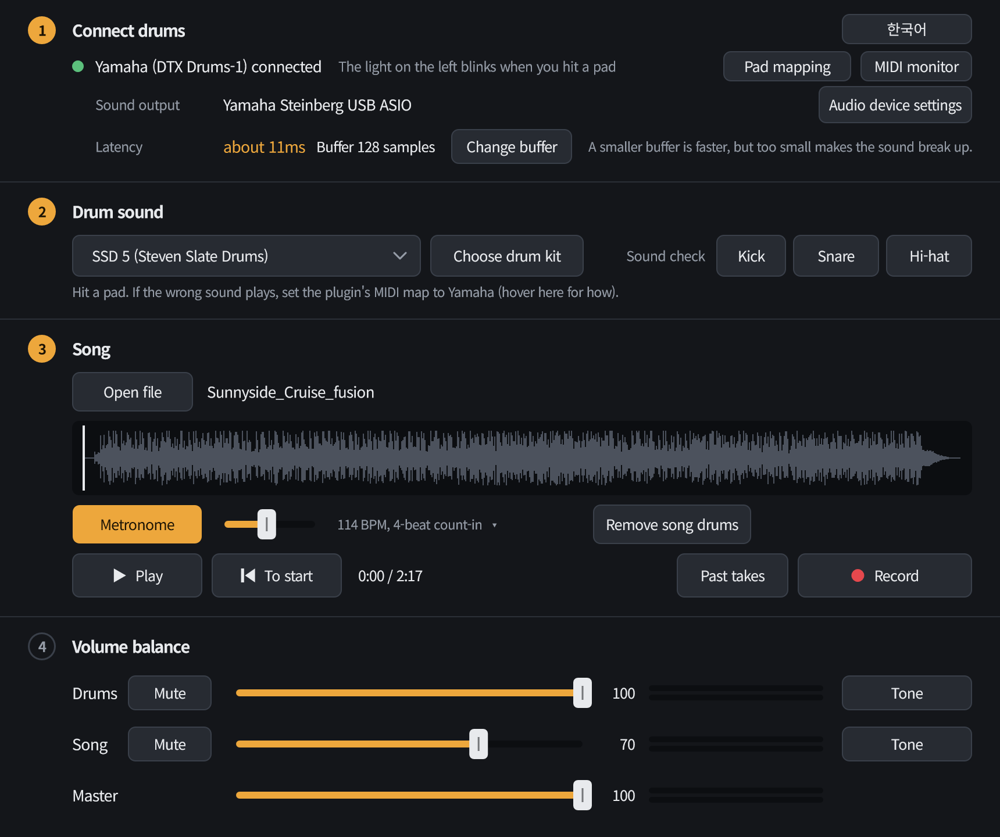
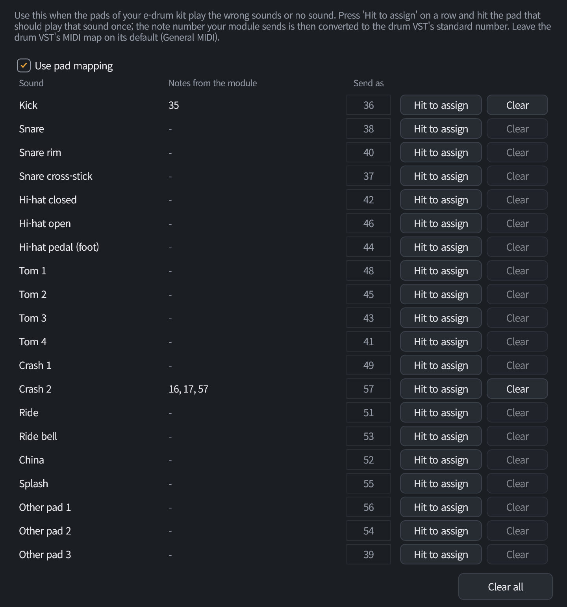

# DrumVstHost

**Play your e-drum kit through a drum VST, along with a song, without opening a DAW.**

A DAW is a heavy tool for a simple job: you sit down at the kit, and before you can play you have to
create a project, add an instrument track, route MIDI, import the song, arm recording… DrumVstHost is a
small, single-window Windows app that does only what a drummer needs, in the order you need it:

1. **Connect drums** – plug in the module, it is found automatically
2. **Drum sound** – pick your drum VST3
3. **Song** – drop in a song and play along
4. **Volume balance** – drums vs. song, done

Everything you need for practice and drum covers is in that one window: low-latency drum sound, song
playback, a metronome that follows the song, removing the original drums, recording, fixing the take,
and saving an MP3.

[한국어 설명은 아래에 있습니다.](#한국어)



| Edit the take | Pad mapping |
|---|---|
|  |  |

## Features

| | What it does |
|---|---|
| **Drum module** | Finds Yamaha DTX and Roland V-Drums modules by name and opens their ASIO driver automatically. Other USB-MIDI kits should work as plain MIDI inputs (use Pad mapping if the notes differ). |
| **Drum VST3** | Scans the standard VST3 folder, recognises drum instruments (Superior Drummer, EZdrummer, Addictive Drums, SSD 5, BFD, MT Power Drum Kit …) and loads one automatically. You can add a plugin file or folder by hand. Each plugin keeps its own kit and settings. |
| **Low latency** | Shows the estimated pad-to-ear latency and tells you which buffer setting to change. About 11 ms measured with a Yamaha DTX-PRO at 128 samples. |
| **Pad mapping** | For any e-drum kit: press a row (Kick, Snare, Hi-hat closed …), hit the pad, done. The app converts the notes your module sends into the standard General MIDI numbers your VST expects. Saved per module. |
| **MIDI monitor** | Shows what each pad actually sends (note, velocity, hi-hat pedal, choke) so you can see why a pad plays the wrong sound. |
| **Play along** | MP3 / WAV / FLAC. Waveform, seek, separate volume, EQ and compressor for drums and song. |
| **Metronome that follows the song** | Finds the beats of the song and clicks on them, with a 4-beat count-in before playback. Double / half speed, and shift the click by half a beat, a quarter beat or 5 ms. Clicks are not recorded. *(optional tools, see below)* |
| **Remove the song's drums** | Separates the original drums (Demucs) so you play over the rest of the band. One button to switch them back. *(optional tools, see below)* |
| **Record** | One button. Saves the mix plus separate drum and song stems. |
| **Edit the take** | Re-balance drums and song, shift the drums ±150 ms (one click to compensate the measured latency), trim the start and end, then save the final mix as **MP3** or WAV. |
| **English / 한국어** | Follows the Windows language; switch with the button at the top right. |

## Getting started

1. Download the zip from [Releases](../../releases), extract it anywhere and run `DrumVstHost.exe`.
   The exe is not code-signed, so Windows SmartScreen may warn on first run: click **More info → Run anyway**.
2. Connect your drum module by USB and switch it on.
3. Pick a drum VST3 in **Drum sound** (you need to have one installed — the free BFD Player works).
4. Hit a pad. If a pad plays the wrong sound, either choose the e-drum MIDI map for your module inside the
   VST (hover over the hint for the exact menu path), or use **Pad mapping**.
5. Open a song and press **Play**, or **Record**.

Requirements: Windows 10/11 (64-bit), a VST3 drum instrument, an e-drum module with USB-MIDI.
An ASIO driver (your module's or your audio interface's) is strongly recommended for low latency.

### Optional: metronome beat detection and drum removal

These two features run Python tools in the background. Everything else works without them.

1. Install [Python 3.10–3.13](https://www.python.org/downloads/) (tick *Add python.exe to PATH*).
2. Run `tools\setup_analysis.bat` once. It creates `.venv` next to the exe (about 1.5 GB, PyTorch CPU + Demucs)
   and downloads the separation model. Nothing is installed system-wide.

Each song is analysed once (beats: tens of seconds, drum removal: about as long as half the song on a 6-core CPU)
and cached in the `Song analysis` folder next to the exe.

### Updating

Extract the new zip over the old folder. Your settings (`%APPDATA%\DrumVstHost`), recordings and analysed
songs are kept. If a plugin crashes the app while loading, the next start skips auto-loading it and tells you.

## Known limitations

- Windows only, VST3 only (no VST2, no AU).
- One drum module and one drum plugin at a time.
- The BFD keymap in `tools\bfd` (all three cymbal zones for Yamaha DTX-PRO) has to be copied to
  `C:\ProgramData\BFD Drums\BFDPlayer\System\Maps` by hand for now.
- **Built for many kits, tested on one.** The only module the author owns is a Yamaha DTX-PRO (DTX6K5-M),
  tested with SSD 5.5 and BFD Player. Support for Roland and other brands is written from manuals and MIDI
  charts and has not been tested on real hardware.

## Feedback

If you use another module (Roland, Alesis, EFNOTE, ATV …), please open an issue and say whether it was
detected, whether the pads mapped correctly, and what latency you get. The MIDI monitor writes a log file
you can attach. New versions will follow that feedback.

## Building from source

Requirements: Visual Studio 2022 Build Tools (MSVC), CMake 3.22+, Ninja, and [JUCE 8](https://github.com/juce-framework/JUCE).

```bat
cmake -S . -B build -G Ninja -DCMAKE_BUILD_TYPE=Release -DJUCE_DIR=C:/path/to/JUCE
cmake --build build --target DrumVstHost
```

`build.bat` is the author's own build script (it expects the tools under `E:\DevTools`).

The UI text lives in the sources in Korean (`K("…")`); the English text is generated from
`tools/dev/strings_en.txt` into `Source/Language.cpp` with `tools/dev/extract_strings.py`.

## License

DrumVstHost is free software under the [GNU Affero General Public License v3](LICENSE).

It is built with [JUCE](https://juce.com) (AGPLv3), the Steinberg VST3 SDK (MIT) and the Steinberg ASIO SDK (GPLv3).
VST is a registered trademark of Steinberg Media Technologies GmbH. ASIO is a trademark and software of
Steinberg Media Technologies GmbH. Drum separation uses [Demucs](https://github.com/adefossez/demucs) (MIT).
Product names mentioned here belong to their owners; this project is not affiliated with any of them.

---

## 한국어

**DAW를 열지 않고, 전자드럼으로 드럼 VST를 치면서 원곡에 맞춰 연주·녹음하는 Windows 앱입니다.**

DAW는 드럼 한 번 치려는 데 쓰기엔 너무 무겁고 번거롭습니다. DrumVstHost는 창 하나에 드럼 연주에 필요한 것만,
쓰는 순서대로(① 드럼 연결 → ② 드럼 소리 → ③ 원곡 → ④ 볼륨 맞추기) 모았습니다.

- 드럼 모듈(Yamaha·Roland 등)과 드럼 VST3를 저절로 찾아 연결, 직접 추가도 가능
- 지연 시간 표시와 버퍼 안내(DTX-PRO, 128샘플에서 약 11ms)
- 어떤 전자드럼이든 패드를 쳐서 맞추는 '패드 맞추기', 받은 신호를 보여 주는 '신호 보기'
- 원곡(MP3·WAV·FLAC)에 맞춰 연주, 원곡 박자를 따라가는 메트로놈(2배·절반, 반 박·1/4박·5ms 조정), 원곡 드럼 빼기
- 한 번에 녹음하고, 볼륨·타이밍·구간을 다듬어 MP3나 WAV로 저장
- 한국어·영어 화면

메트로놈 박자 찾기와 원곡 드럼 빼기는 파이썬 도구가 필요합니다. 파이썬 3.10~3.13을 설치한 뒤
`tools\setup_analysis.bat`을 한 번 실행하세요(약 1.5GB). 나머지 기능은 그대로 쓸 수 있습니다.
