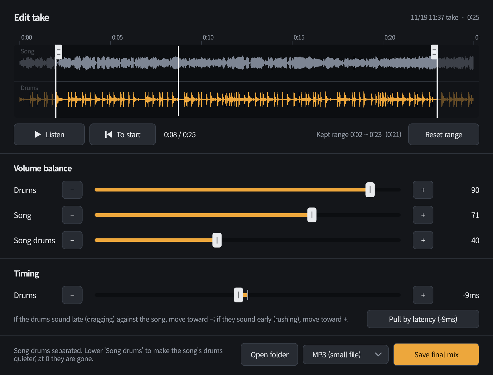

# DrumVstHost

**Play your e-drum kit through a drum VST, along with a song, without opening a DAW.**

A DAW is a heavy tool for a simple job: you sit down at the kit, and before you can play you have to
create a project, add an instrument track, route MIDI, import the song, arm recording… DrumVstHost is a
small, single-window Windows app that does only what a drummer needs, in the order you need it:

1. **Connect drums** – plug in the module, it is found automatically
2. **Drum sound** – pick your drum VST3
3. **Song** – drop in a song and play along
4. **Volume balance** – drums vs. song, done

Everything you need for practice and drum covers is in that one window: low-latency drum sound, song
playback, a metronome that follows the song, removing the original drums, recording, fixing the take,
and saving an MP3.

[한국어 설명은 아래에 있습니다.](#한국어)


| Edit the take | Pad mapping |
|---|---|
|  |  |

## Features

| | What it does |
|---|---|
| **Drum module** | Finds Yamaha DTX and Roland V-Drums modules by name and opens their ASIO driver automatically. Other USB-MIDI kits should work as plain MIDI inputs (use Pad mapping if the notes differ). |
| **Drum VST3** | Scans the standard VST3 folder, recognises drum instruments (Superior Drummer, EZdrummer, Addictive Drums, SSD 5, BFD, MT Power Drum Kit …) and loads one automatically. You can add a plugin file or folder by hand. Each plugin keeps its own kit and settings. |
| **Low latency** | Shows the estimated pad-to-ear latency, what it is made of, and which driver setting to change. With a Yamaha DTX-PRO, Mode Low Latency and a 96-sample buffer: about 9.5 ms plus the drum VST's own latency (Low Latency is about 1 ms faster than Standard) — the app tells you when the driver is not on Low Latency. For Yamaha drivers, the experimental **Faster** menu shrinks the driver's own safety margin in 1 ms steps: on a DTX-PRO, 3 ms faster worked and 4 ms crackled on the toms, so listen and step down if it crackles. |
| **Pad mapping** | For any e-drum kit: press a row (Kick, Snare, Hi-hat closed …), hit the pad, done. The app converts the notes your module sends into the standard General MIDI numbers your VST expects. Saved per module. |
| **MIDI monitor** | Shows what each pad actually sends (note, velocity, hi-hat pedal, choke) so you can see why a pad plays the wrong sound. It can also drop very weak tom hits caused by crosstalk (vibration from the hi-hat or snare), which some drum VSTs play as an audible thump. |
| **Play along** | MP3 / WAV / FLAC. Waveform, seek, separate volume, EQ and compressor for drums and song. |
| **Metronome that follows the song** | Finds the beats of the song and clicks on them, with a 4-beat count-in before playback. Double / half speed, and shift the click by half a beat, a quarter beat or 5 ms. Clicks are not recorded. *(optional tools, see below)* |
| **Remove the song's drums** | Separates the original drums (Demucs) so you play over the rest of the band. One button to switch them back. *(optional tools, see below)* |
| **Record** | One button. Saves the mix plus separate drum and song stems, and the MIDI of what you played. |
| **Fix your playing in EZdrummer** | Each take also saves `performance.mid`: your hits in standard drum notes (GM), with the song's beats as the tempo so bar 1 starts on the song's first downbeat. Drag it from **Edit take** into the EZdrummer Song Track (or a DAW), quantize or add ghost notes, then drop the edited MIDI back onto **Edit take**: the app rebuilds the drum track with your current drum VST and kit. Unchanged notes keep their original articulation (rims, edges, hi-hat pedal); **Rebuild with current kit** re-renders the take with whatever kit or drum VST is chosen now, without touching the performance. **Back to as recorded** undoes any rebuild. For timing alone you can skip EZdrummer: **Fix timing** pulls the hits toward the song's beat grid (8th to 32nd notes or triplets, at 50-100% strength) right in the app, and **Add ghost notes** fills the empty 16th-note slots around your strong snare hits with very quiet snares. |
| **Edit the take** | Re-balance drums and song, turn the song's own drums down or off (**Song drums**), shift the drums ±150 ms (one click to compensate the measured latency), trim the start and end, then save the final mix as **MP3** or WAV. Takes recorded over a separated song can do this right away; for older takes, press **Separate song drums** once - if the song itself was separated before (Remove the song's drums), the app reuses that result and finishes in seconds instead of running the separation again. |
| **English / 한국어** | Follows the Windows language; switch with the button at the top right. |

## Getting started

1. Download the zip from [Releases](../../releases), extract it anywhere and run `DrumVstHost.exe`.
   The exe is not code-signed, so Windows SmartScreen may warn on first run: click **More info → Run anyway**.
2. Connect your drum module by USB and switch it on.
3. Pick a drum VST3 in **Drum sound** (you need to have one installed — the free BFD Player works).
4. Hit a pad. If a pad plays the wrong sound, either choose the e-drum MIDI map for your module inside the
   VST (hover over the hint for the exact menu path), or use **Pad mapping**.
5. Open a song and press **Play**, or **Record**.

Requirements: Windows 10/11 (64-bit), a VST3 drum instrument, an e-drum module with USB-MIDI.
An ASIO driver (your module's or your audio interface's) is strongly recommended for low latency.

### Metronome beat detection and drum removal (one-click download)

These two features run analysis tools in the background. The first time you press **Metronome** or
**Remove song drums**, the app offers to download them — no Python install or command line needed:

| | Download | On disk |
|---|---|---|
| Beat detection (metronome) | about 85 MB | about 250 MB |
| + Drum removal (PyTorch CPU, Demucs, separation model) | about 300 MB | about 1 GB |

Progress is shown next to the button (click it to stop), and the app carries on with what you asked for when
the download finishes. Everything goes into an `analysis` folder next to the exe (or
`%LOCALAPPDATA%\DrumVstHost\analysis` if that folder is read-only): a private Python 3.12 installed by
[uv](https://github.com/astral-sh/uv) (pinned version, SHA-256 checked), the Python packages from PyPI, and the
Demucs model from Hugging Face. Nothing is installed system-wide; delete the folder to remove it.
The last install log is `analysis\install-log.txt`.

Each song is analysed once (beats: tens of seconds, drum removal: about as long as half the song on a 6-core CPU)
and cached in the `Song analysis` folder next to the exe.

### Updating

Extract the new zip over the old folder. Your settings (`%APPDATA%\DrumVstHost`), recordings, analysed
songs and downloaded analysis tools are kept. If a plugin crashes the app while loading, the next start skips
auto-loading it and tells you.

## Known limitations

- Windows only, VST3 only (no VST2, no AU).
- One drum module and one drum plugin at a time.
- The BFD keymap in `tools\bfd` (all three cymbal zones for Yamaha DTX-PRO) has to be copied to
  `C:\ProgramData\BFD Drums\BFDPlayer\System\Maps` by hand for now.
- An Addictive Drums 2 map for the Yamaha DTX-PRO is in `tools\ad2` (hi-hat pedal, foot splash, tom rims, ride zones).
  Copy it to `Documents\Addictive Drums 2\<number>` and pick it under the menu → MIDI Mapping → My Maps.
- **Built for many kits, tested on one.** The only module the author owns is a Yamaha DTX-PRO (DTX6K5-M),
  tested with SSD 5.5 and BFD Player. Support for Roland and other brands is written from manuals and MIDI
  charts and has not been tested on real hardware.

## Feedback

If you use another module (Roland, Alesis, EFNOTE, ATV …), please open an issue and say whether it was
detected, whether the pads mapped correctly, and what latency you get. The MIDI monitor writes a log file
you can attach. New versions will follow that feedback.

## Building from source

Requirements: Visual Studio 2022 Build Tools (MSVC), CMake 3.22+, Ninja, and [JUCE 8](https://github.com/juce-framework/JUCE).

```bat
cmake -S . -B build -G Ninja -DCMAKE_BUILD_TYPE=Release -DJUCE_DIR=C:/path/to/JUCE
cmake --build build --target DrumVstHost
```

`build.bat` is the author's own build script (it expects the tools under `E:\DevTools`).

The UI text lives in the sources in Korean (`K("…")`); the English text is generated from
`tools/dev/strings_en.txt` into `Source/Language.cpp` with `tools/dev/extract_strings.py`.

## License

DrumVstHost is free software under the [GNU Affero General Public License v3](LICENSE).

It is built with [JUCE](https://juce.com) (AGPLv3), the Steinberg VST3 SDK (MIT) and the Steinberg ASIO SDK (GPLv3).
VST is a registered trademark of Steinberg Media Technologies GmbH. ASIO is a trademark and software of
Steinberg Media Technologies GmbH. Drum separation uses [Demucs](https://github.com/adefossez/demucs) (MIT).
Product names mentioned here belong to their owners; this project is not affiliated with any of them.

---

## 한국어

**DAW를 열지 않고, 전자드럼으로 드럼 VST를 치면서 원곡에 맞춰 연주·녹음하는 Windows 앱입니다.**

DAW는 드럼 한 번 치려는 데 쓰기엔 너무 무겁고 번거롭습니다. DrumVstHost는 창 하나에 드럼 연주에 필요한 것만,
쓰는 순서대로(① 드럼 연결 → ② 드럼 소리 → ③ 원곡 → ④ 볼륨 맞추기) 모았습니다.

- 드럼 모듈(Yamaha·Roland 등)과 드럼 VST3를 저절로 찾아 연결, 직접 추가도 가능
- 지연 시간 표시와 드라이버 설정 안내(DTX-PRO, 드라이버 Mode Low Latency·버퍼 96: 약 9.5ms + 드럼 VST 자체 지연. Low Latency는 Standard보다 약 1ms 빠름)
- Yamaha 드라이버의 여유를 1ms씩 줄이는 '더 빠르게'(실험, DTX-PRO에서 3ms까지 괜찮고 4ms는 자글거림)
- 어떤 전자드럼이든 패드를 쳐서 맞추는 '패드 맞추기', 받은 신호를 보여 주는 '신호 보기'(크로스토크로 들어오는 약한 탐 신호 거르기)
- 원곡(MP3·WAV·FLAC)에 맞춰 연주, 원곡 박자를 따라가는 메트로놈(2배·절반, 반 박·1/4박·5ms 조정), 원곡 드럼 빼기
- 한 번에 녹음하고, 볼륨·타이밍·구간을 다듬어 MP3나 WAV로 저장(다듬을 때 원곡 속 드럼만 줄이거나 뺄 수 있음)
- 녹음마다 연주 MIDI(`연주.mid`)도 남김: 원곡 박자를 템포로 적어 이지드러머 Song Track에 끌어다 놓고 박자 맞추기·고스트 노트를 한 뒤, 고친 MIDI를 다듬기 창에 놓으면 지금 드럼 VST로 드럼을 다시 만듦(림·엣지·하이햇 페달은 원래대로, '지금 킷 소리로 다시 만들기'로 킷만 바꿔 듣기, '녹음 그대로 되돌리기' 가능)
- 박자만 고칠 땐 이지드러머 없이 다듬기 창 '박자 맞추기'로 원곡 박 격자(8분~32분·셋잇단, 세기 50~100%)에 끌어당기고, '고스트 노트 넣기'는 세게 친 스네어 둘레 빈 16분 자리에 아주 약한 스네어를 채움; '원곡 드럼 분리'는 이미 분리해 둔 곡이면 그 결과를 가져와 몇 초 만에 끝남
- 한국어·영어 화면

메트로놈 박자 찾기와 원곡 드럼 빼기에 쓰는 분석 도구는 처음 그 버튼을 누를 때 앱이 내려받기를 권합니다.
'내려받기'만 누르면 되고 파이썬을 따로 설치할 필요가 없습니다(박자 찾기 약 85MB, 드럼 빼기까지 약 300MB 내려받기).
도구는 앱 폴더의 `analysis` 폴더에 들어가며, 지우면 깨끗이 없어집니다.
